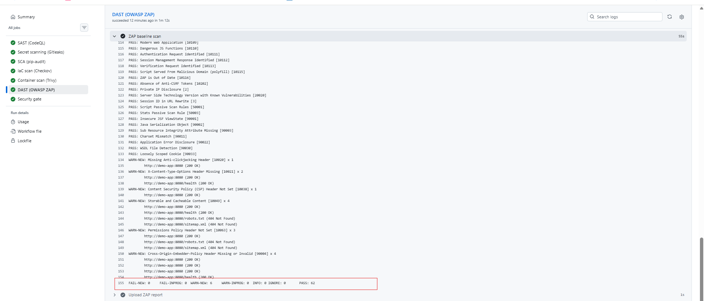
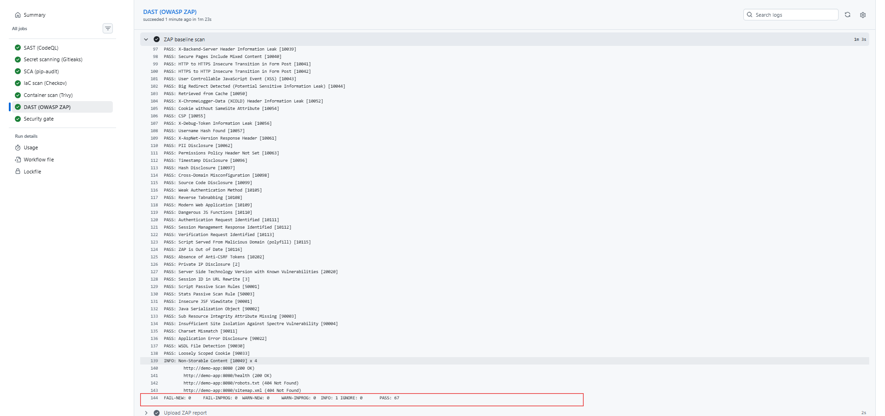

# DevSecOps Pipeline Template

A reusable GitHub Actions pipeline that adds security gates to a Python service: static analysis, secret scanning, dependency scanning, infrastructure-as-code scanning, container scanning, and dynamic application testing. Scanner findings appear in the GitHub Security tab, the ZAP report is saved as a build artifact, and a single required check blocks merges that fail.

> Demo project built on a sample app. It contains no employer code, configuration, or data.

## What it does

| Stage | Tool | Catches |
|---|---|---|
| SAST | CodeQL | Insecure code patterns |
| Secrets | Gitleaks | Credentials committed to the repo |
| SCA | pip-audit | Known-vulnerable Python dependencies |
| IaC | Checkov | Terraform misconfigurations |
| Container | Trivy | HIGH/CRITICAL image vulnerabilities |
| DAST | OWASP ZAP | Missing security headers and other runtime weaknesses in the running app |
| Gate | `security-gate` job | Blocks merging unless every stage passes |

```
push / pull request
   |
   +--> CodeQL -------+
   +--> Gitleaks -----+
   +--> pip-audit ----+--> Security gate --> merge allowed
   +--> Checkov ------+
   +--> Trivy --------+
   +--> OWASP ZAP ----+
```

## Repository layout

```
.github/workflows/security.yml   the pipeline
app/                             sample Flask app (with security headers), Dockerfile, requirements
terraform/main.tf                demo S3 + KMS infrastructure (scanned, never deployed)
docs/DEMO.md                     steps to trigger failing checks on purpose
```

## Branch protection

`main` is protected by a repository ruleset that requires the **Security gate** status check. Changes go through pull requests, and the merge button stays disabled until all six scanners pass. Pull request #1 ran all checks (five scanner jobs, three code-scanning results, and the gate) before merging; the ZAP stage was added later in its own pull request.

## Results

Real findings the pipeline caught while I was building it, and what I did about each:

### 1. Vulnerable dependency (SCA)
pip-audit flagged **Flask 3.0.3** with a known vulnerability (fixed in 3.1.3). I upgraded the pin, and the Trivy report later confirmed every Python package in the image shows **0 vulnerabilities**.

### 2. Infrastructure misconfigurations (IaC)
Checkov reported **5 failed checks** on the first version of the S3 bucket. Triage:

| Check | Decision |
|---|---|
| Encryption with KMS | **Fixed:** added a KMS key with rotation and a key policy |
| Access logging | **Fixed:** added a log bucket and logging configuration |
| Lifecycle configuration | **Fixed:** added expiration and cleanup rules |
| Event notifications | **Skipped:** not needed for a demo bucket (reason documented in code) |
| Cross-region replication | **Skipped:** out of scope for a demo bucket (reason documented in code) |

Skips use `checkov:skip` comments with a written justification, so every exception is reviewable. The log bucket also skips self-logging to avoid a logging loop.

### 3. Container vulnerabilities (Trivy)
Trivy found **49 HIGH findings** in the Debian 13.7 base image, all in OS packages, none in Python code. Most were the same few CVEs repeated across packages (for example, util-linux issues listed under eight packages), and most had **no vendor fix available yet** (status `affected` or `fix_deferred`). Triage:

- Added `apt-get upgrade` to the Dockerfile to pick up available patches (the readable report still lists everything unfixed).
- Configured the gate with `ignore-unfixed: true`, so builds fail on vulnerabilities that **can** be patched rather than on ones nobody can fix yet.
- Kept a separate readable report step that prints **all** HIGH/CRITICAL findings, so nothing is hidden.

### 4. Code scanning dashboard
After the fixes, GitHub's Code scanning page showed **200 closed alerts** from earlier runs and **5 open** ones. The 5 open alerts were Checkov's reports of the checks I deliberately skipped (above). I dismissed each as **Won't fix** with a written reason, so the dashboard now records the same decision as the `checkov:skip` comments. CodeQL and Trivy had no open alerts.

### 5. Dynamic testing (DAST)
The pipeline builds the container, starts it on a private Docker network, and runs a **ZAP baseline scan** (ZAP 2.17.0) against it. The baseline scan is passive: it crawls the app and inspects responses without sending attack payloads. The first scan reported **6 warnings, 0 failures, 62 passes**, all missing HTTP security headers:

| ZAP finding | Resolution |
|---|---|
| Missing Anti-clickjacking Header | **Fixed:** `X-Frame-Options` and CSP `frame-ancestors` |
| X-Content-Type-Options Header Missing | **Fixed:** `X-Content-Type-Options: nosniff` |
| Content Security Policy (CSP) Header Not Set | **Fixed:** restrictive `Content-Security-Policy` |
| Permissions Policy Header Not Set | **Fixed:** `Permissions-Policy` |
| Cross-Origin-Embedder-Policy Missing or Invalid | **Fixed:** COEP, COOP, and CORP headers |
| Storable and Cacheable Content | **Fixed, then reclassified:** `Cache-Control: no-store` stops caching, but ZAP then reports the response as "Non-Storable Content" (informational). That is the intended behavior, so rule 10049 is set to INFO with a documented reason |

After the fixes the scan reports **0 warnings, 0 failures, 67 passes, and 1 informational note**. The headers are set for every response in one `after_request` hook in `app/app.py`, including 404 pages.

### Screenshots


*A passing run from before the DAST stage was added: all five scanners finish green and the Security gate unlocks merging.*


*A pull request with a deliberate misconfiguration: Checkov fails, the Security gate does not pass, and the merge button is disabled.*


*First ZAP baseline scan: 6 warnings for missing security headers, 62 rules passed.*


*After adding security headers: 0 warnings, 67 rules passed, and one informational note about non-cacheable responses.*


*The Code scanning dashboard after the fixes: 200 earlier alerts closed, and the deliberately skipped checks dismissed with written reasons.*

## Using it in your own repo

1. Copy `.github/workflows/security.yml` into your repository.
2. Adjust the paths (`app/`, `terraform/`) and the CodeQL language.
3. Enable code scanning under *Settings > Advanced Security* so SARIF results appear in the Security tab.
4. Run the pipeline once so the **Security gate** check exists.
5. Under *Settings > Rules > Rulesets*, create a branch ruleset for the default branch that requires the **Security gate** check.
6. The `dast-zap` job assumes the app listens on port 8080 and answers `/health`. Change those in the job if yours differs.

## Design decisions

- **Fail closed, but on actionable findings.** Trivy blocks on fixable HIGH/CRITICAL vulnerabilities; unfixed ones stay visible in the report.
- **Least privilege.** Workflow permissions are read-only except `security-events: write` for uploading SARIF.
- **One required check.** A single gate job keeps branch protection simple as scanners are added or swapped.
- **Documented exceptions.** Every skipped check carries a written reason.
- **Strict DAST gate.** ZAP runs without `-I`, so any warning fails the build. The tradeoff is that a ZAP update adding new rules could fail the pipeline without a code change; if that becomes noisy, the gate can move to a rules file that fails only on chosen rules.

## Lessons learned

- Action versions need checking. A pinned `trivy-action` tag I started with no longer existed, and the project's release notes mention a previously compromised release. Tags can move, so pinning to a commit SHA is the stronger practice (see roadmap).
- Scanner output needs triage. 49 findings turned out to be about a dozen distinct CVEs, most without fixes.
- Some scanner rules alert no matter what you do. ZAP's cache rule reports a response as cacheable or as non-storable, so the right answer was to downgrade it with a written reason rather than weaken the header.
- SARIF output ignores severity filters unless told otherwise (`limit-severities-for-sarif`), which can make a gate fail on findings you never meant to block on.

## Roadmap

- [ ] Pin all actions to commit SHAs
- [ ] Add SBOM generation (Syft) and image signing (Cosign)
- [x] Add a DAST stage with OWASP ZAP against the running container
- [ ] Extend DAST to an authenticated or active scan against a richer app
- [ ] Move to a minimal or distroless base image to shrink the OS attack surface
- [ ] Publish as a reusable workflow (`workflow_call`)
- [ ] Add a scheduled run to catch newly published CVEs
