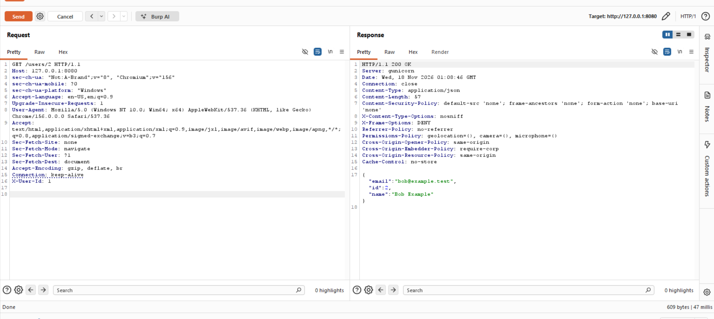
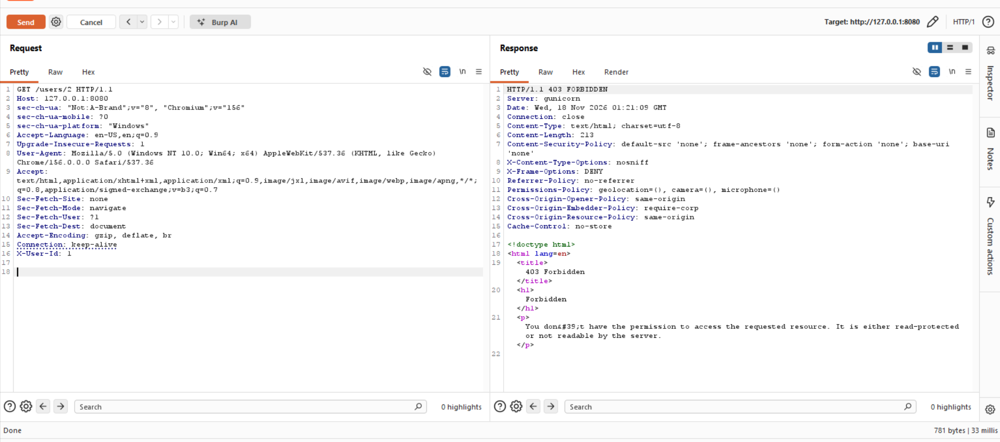

# Burp Suite Findings: Broken Access Control in a Demo API

**Scope:** a small Flask demo app I wrote for this repository, run locally in Docker (`127.0.0.1:8080`). The flaw was introduced deliberately so I could practice finding, proving and verifying a fix for an access control issue. No third-party systems were tested, and all data is fake.

**Tools:** Burp Suite Community (Proxy, HTTP history, Repeater), Docker, curl.

## Summary

| Field | Detail |
|---|---|
| Finding | Insecure direct object reference (IDOR): any caller can read any user's record |
| Endpoint | `GET /users/<id>` |
| Weakness | CWE-639 (Authorization Bypass Through User-Controlled Key) |
| OWASP | Top 10 2021 A01: Broken Access Control |
| Severity | High in a real application (exposure of other users' personal data). Demo data only here |
| Status | Fixed and retested |

## How the app identifies the caller

The demo app trusts an `X-User-Id` request header as the logged-in user. A real application would derive identity from a session or signed token. The header is a stand-in so the authorization logic can be tested without building a login system.

## Reproduction

1. Start the vulnerable build: `docker run --rm -p 127.0.0.1:8080:8080 demo-app-vulnerable`.
2. Browse to `/users/1` through Burp's browser, then send the request to Repeater.
3. Add the header `X-User-Id: 1` (acting as Alice, user 1).
4. Change the path to `/users/2` (Bob's record) and send.

**Result:** `200 OK` with Bob's name and email, returned to a caller identified as user 1.


*Repeater: the request is made as user 1 and Bob's record (user 2) comes back with a 200.*

## Root cause

The route looked the record up by the ID in the URL and returned it. It never compared that ID with the identity of the caller, so identity played no part in the access decision.

## Fix

Added an ownership check before returning data:

```python
if user_id != current_user_id():
    abort(403)
```

The check is enforced on the server for every request. Hiding or changing IDs on the client side would not be a fix.

## Retest

Same request against the fixed build (`demo-app-fixed`):

| Request | Result |
|---|---|
| `GET /users/2` with `X-User-Id: 1` | `403 Forbidden` |
| `GET /users/1` with `X-User-Id: 1` | `200 OK`, own record returned |


*Repeater: the same request now returns 403.*

## Recommendations for a real application

- Enforce authorization on the server for every object access, not only at login.
- Derive the caller's identity from a verified session or token, never from a client-supplied header.
- Add an automated test that requests another user's resource and expects 403 or 404, so the flaw cannot return unnoticed.
- Consider returning 404 instead of 403 for other users' objects, so the existence of IDs is not revealed.
- Use unpredictable identifiers (UUIDs) as defense in depth. They do not replace the authorization check.

## Related work in this repository

- A custom Semgrep rule that flags Flask routes returning a record by ID without an ownership check (see `docs/CODE_REVIEW.md`).
- The CI pipeline's scans (CodeQL, Gitleaks, pip-audit, Checkov, Trivy, ZAP). The ZAP baseline scan is passive, which is why this flaw needed manual testing with Burp.

## Limitations

This was a test of my own demo app with a flaw I planted. It shows my testing and verification process, not a discovery in production software. The authentication model is simplified on purpose.
