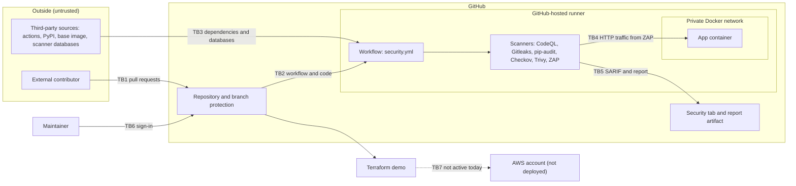

# Threat Model: DevSecOps Pipeline Template

**Status:** in progress. This version covers scope, assets, actors, trust boundaries, a data flow diagram and a STRIDE threat list. Mitigations and residual risk will be added.

## Scope

**In scope**

- The sample Flask app (`app/app.py`) and its Dockerfile
- The container image built on every pipeline run
- The GitHub Actions workflow (`.github/workflows/security.yml`)
- The repository, its branch protection ruleset, and its contributors
- Scanner output: SARIF results, the Security tab, and the ZAP report artifact
- The demo Terraform in `terraform/` (scanned only, never deployed)

**Out of scope for now**

- Any AWS deployment. The Terraform is not applied today. This document will be updated when that changes.
- The security of GitHub's own platform and hosted runners.

## What the system does

On every pull request, GitHub Actions builds the container and runs six scanners: CodeQL, Gitleaks, pip-audit, Checkov, Trivy and OWASP ZAP. A single required check, **Security gate**, must pass before a change can merge into `main`.

## Assets: what we are protecting

| ID | Asset | Why it matters | Where it lives |
|---|---|---|---|
| A1 | Source code and commit history | Tampering changes what ships and what gets scanned | GitHub repository |
| A2 | Pipeline definition (`security.yml`) | If it is altered, a gate can be weakened or removed | `.github/workflows/` |
| A3 | Branch protection ruleset and the Security gate | The control that blocks failing changes from `main` | GitHub repository settings |
| A4 | Workflow token (`GITHUB_TOKEN`) | The only credential the pipeline uses. Permissions are read-only except `security-events: write` | GitHub Actions runtime |
| A5 | Third-party code pulled into builds (actions, pip packages, base image) | A compromised dependency runs inside the pipeline | PyPI, Docker base image, action repositories |
| A6 | Container image | Contains the app and its OS packages | Built on the runner, not published |
| A7 | Scan results and reports | Altered or hidden results would give false assurance | Security tab, ZAP report artifact |
| A8 | Terraform demo code | Would define real cloud resources if it were applied | `terraform/main.tf` |
| A9 | Maintainer's GitHub account | Account takeover would bypass most other controls | GitHub |

**Secrets:** the repository stores no real secrets. Any credential-like value used for testing must be fake and clearly labeled.

## Actors

- **Maintainer:** the repository owner
- **External contributor:** anyone who can open a pull request or fork the public repo
- **Attacker:** an external contributor with bad intent, or someone who compromises a dependency or the maintainer's account
- **Third-party publishers:** maintainers of the actions, packages and images the pipeline depends on

## Trust boundaries

| ID | Boundary | What crosses it | Notes |
|---|---|---|---|
| TB1 | Internet and contributors / GitHub repository | Pull requests, forks, issues | The repo is public. Forked pull requests get a read-only token and no secrets by default |
| TB2 | Repository / GitHub Actions runner | Workflow code and repo contents | The workflow runs on a GitHub-hosted runner, so changes to `security.yml` change what runs |
| TB3 | Runner / third-party sources | Actions, pip packages, base image, scanner databases | Code and data from outside our control enter the build |
| TB4 | Runner / app container | HTTP traffic from ZAP and the health check | The container runs on a private Docker network, with port 8080 mapped to the runner's localhost only |
| TB5 | Pipeline / Security tab and artifacts | SARIF uploads and the ZAP report | Needs `security-events: write`. Results could be altered or suppressed |
| TB6 | Maintainer / GitHub account | Sign-in and sessions | Depends on account authentication settings (see assumptions) |
| TB7 | Terraform / cloud account | Infrastructure changes | Not active today. It becomes a boundary when the app is deployed to AWS |

## Data flow diagram

Trust boundaries from the table above are labeled TB1 to TB7 on the arrows where data crosses them.

## Threats (STRIDE)

Each asset and trust boundary was reviewed against the six STRIDE categories: **S**poofing, **T**ampering, **R**epudiation, **I**nformation disclosure, **D**enial of service, and **E**levation of privilege. Mitigations and residual risk for each threat will be documented separately.

| ID | STRIDE | Asset / boundary | Threat |
|---|---|---|---|
| T1 | S | A9, TB6 | An attacker steals the maintainer's credentials or session and pushes or merges changes as the maintainer |
| T2 | S | A5, TB3 | A lookalike or typosquatted package, action or image is pulled into the build in place of the legitimate one |
| T3 | S | A3, TB5 | A status check with the same name as **Security gate**, from another source, satisfies the required check, depending on how the check's source is configured |
| T4 | T | A2, TB2 | A pull request edits `security.yml` to remove or weaken a scanner or the gate, and its own run is judged by the modified workflow |
| T5 | T | A5, TB3 | A third-party action referenced by a version tag is moved to malicious code, which then runs in the pipeline |
| T6 | T | A7, TB5 | Findings are hidden by skip comments, rule downgrades, or dismissed alerts that lack a real justification |
| T7 | T | A5, A6, TB3 | A vulnerable or malicious version of a pip package or the base image enters the build and ships in the container |
| T8 | R | A3, A9 | Changes to branch protection or alert dismissals cannot be attributed or explained later, because a personal repository may keep limited history |
| T9 | R | A1, TB1 | A contributor denies authoring a malicious commit, and unsigned commits make attribution unreliable |
| T10 | I | A1, A4 | A real credential or token is committed to the repo or printed in a workflow log |
| T11 | I | A7, TB5 | Detailed scan reports and the Security tab reveal unpatched weaknesses to an attacker, which matters on a real project that is public |
| T12 | I | A8 | Terraform code or variables expose real infrastructure details such as account IDs or resource names |
| T13 | D | TB1, TB2 | Many pull requests or workflow runs exhaust Actions capacity and block legitimate checks |
| T14 | D | TB3 | An outage or rate limit at a scanner database, registry or action source makes the gate fail, which blocks merges |
| T15 | E | A2, A6, TB2, TB4 | A pull request changes the Dockerfile or workflow so that arbitrary commands run on the runner during the build or scan |
| T16 | E | A4, TB2 | A compromised action uses the workflow token's permissions, such as `security-events: write`, to upload false results or reach beyond its purpose |

## Assumptions

This model assumes the following repository and account settings are in place:

- Multi-factor authentication is enabled on the maintainer's GitHub account.
- Secret scanning and push protection are enabled for the repository.
- Workflows are triggered by `pull_request` and do not use `pull_request_target`.
- Workflow permissions stay limited to what each job needs.
